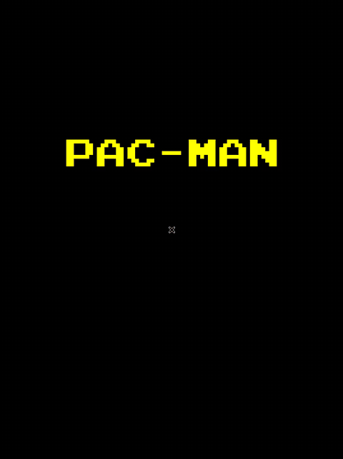

# Pac-Man em C++ (SFML)

Recriação do clássico Pac-Man feita em C++ com a biblioteca SFML.
Projeto educacional, sem fins lucrativos.



## Recursos

- Menu inicial, tela de Game Over e tela de vitória
- Quatro fantasmas: dois perseguidores e dois aleatórios
- Os perseguidores usam um algoritmo guloso: a cada passo, escolhem a direção que mais diminui a distância até o alvo
- Pílulas de força que assustam os fantasmas
- Frutas bônus (cereja, laranja, ananás e morango)
- Túnel lateral de teleporte
- Recorde de pontuação
- Música de fundo e fonte retrô

## Controles

- **Enter**: iniciar o jogo
- **Setas**: mover o Pac-Man
- **Esc**: sair
- **R**: reiniciar | **M**: voltar ao menu (após Game Over/vitória)


## Como compilar

Requer um compilador C++20 e a **SFML 3**.

```
g++ pacman.cpp -o pacman -std=c++20 -lsfml-graphics -lsfml-window -lsfml-system -lsfml-audio
./pacman
```

Execute a partir da pasta do projeto.

## Autores

- Caio Guilherme Gonzaga Silvestre
- Arthur Saraiva
